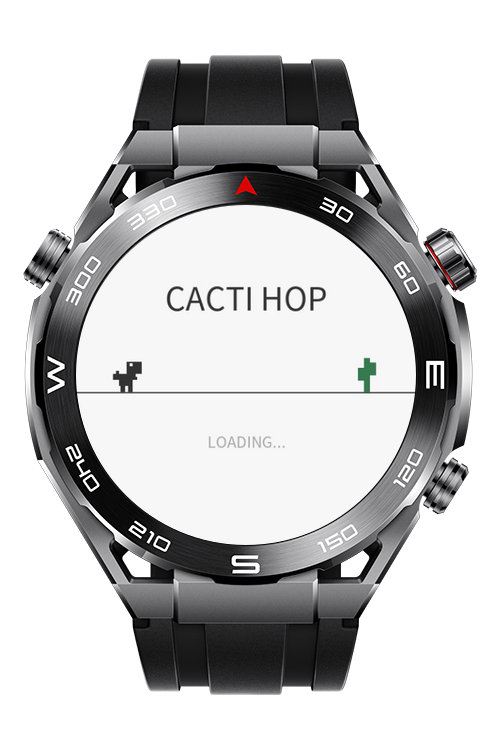
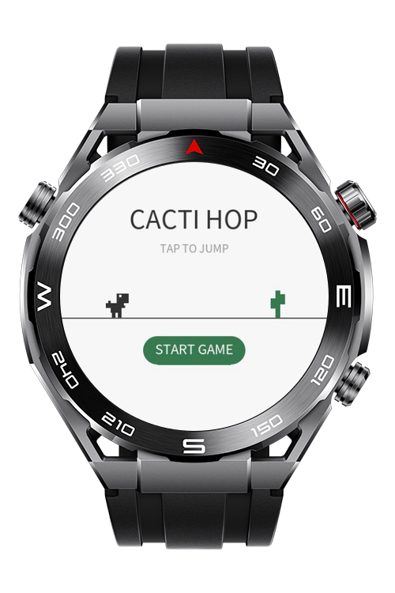
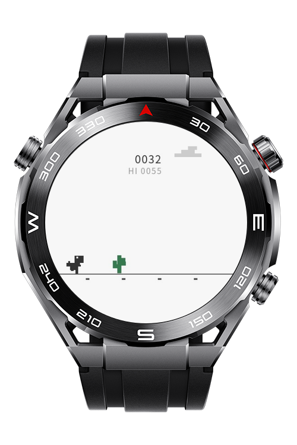
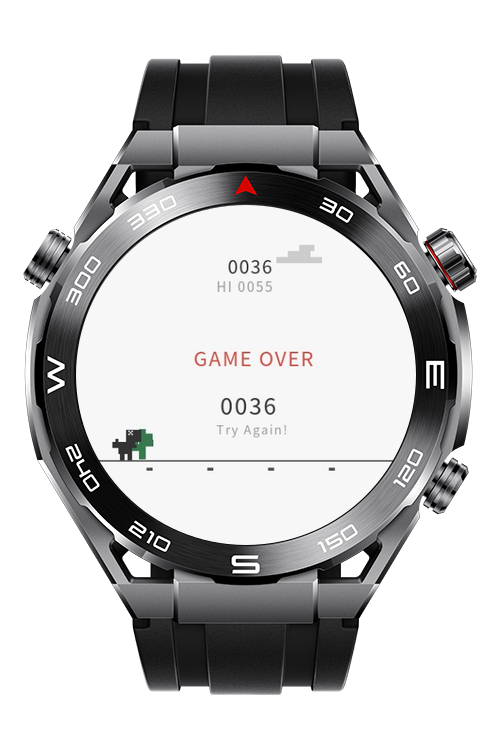

> **Note:** To access all shared projects, get information about environment setup, and view other guides, please visit [Explore-In-HMOS-Wearable Index](https://github.com/Explore-In-HMOS-Wearable/hmos-index).

# Cacti Hop

This retro-style endless runner game allows users to control a pixelated dinosaur, jump over cacti, and compete for the highest score directly from their smartwatch. The game features dynamic speed increments, custom pixel-art rendering on canvas, and local high-score tracking.

# Preview

<div>
  
  
  
  
</div>

# Use Cases

- Play a fast-paced endless runner game on a wearable device.
- Tap the screen to make the dinosaur jump over incoming cactus obstacles.
- Track current score and beat your personal high score.

# Tech Stack

- **Languages**: HML, CSS, JS
- **Frameworks**: HarmonyOS Lite Wearable API
- **Tools**: DevEco Studio Version 6.0.1.251 (or compatible)
- **Libraries**: @system.router

# Directory Structure

```
entry/src/main/js/MainAbility
│   app.js
└───pages
    ├───splash_screen
    │       splash_screen.css
    │       splash_screen.hml
    │       splash_screen.js
    ├───start_screen
    │       start_screen.css
    │       start_screen.hml
    │       start_screen.js
    └───game_screen
            game_screen.css
            game_screen.hml
            game_screen.js
```
# Constraints and Restrictions

## Supported Devices
-Huawei Sport (Lite) Watch GT 4/5/6
-Huawei Sport (Lite) GT4/5 Pro
-Huawei Sport (Lite) Fit 3/4
-Huawei Sport (Lite) D2
-Huawei Sport (Lite) Ultimate

# License
Cacti Hop is distributed under the terms of the MIT License.  
See the [LICENSE](/LICENSE) for more information.